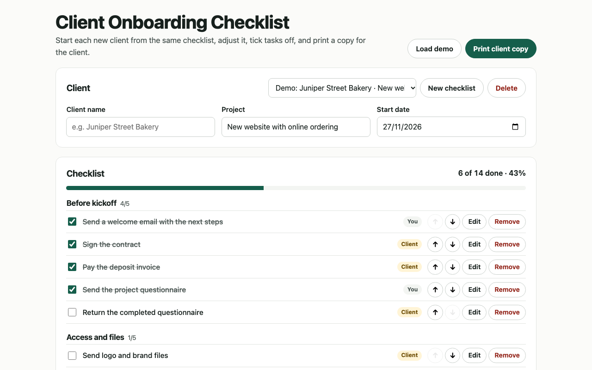

# Client Onboarding Checklist

A small browser page for starting every new client the same way. It comes with a reusable onboarding checklist that you can change to fit how you work. Tick tasks off as they happen, and print a clean copy that shows the client what you need from them.

There is nothing to install and no account to create. The project is free and open-source under the [MIT License](LICENSE).



## Example

Demo: Lantern Books signs up for a new online store. You click **New checklist**, type the client and project names, and get the standard list: contract, deposit, questionnaire, brand files, logins, kickoff call. They also need to send their book list, so you add that task and mark it for the **Client**. As things arrive you tick them off and the progress bar fills up. Before the kickoff call you choose **Only the tasks for the client** and click **Print client copy** to send them a one-page list of what's still missing.

## What it does

- A ready-made checklist in three sections: before kickoff, access and files, and kickoff.
- Add, edit, remove, and reorder tasks. Mark each one as yours or the client's.
- Progress for the whole checklist and for each section.
- Several checklists, one per client. Switch between them from the list.
- Save any checklist as your template, so every new client starts with your version. Reset to the default at any time.
- Print a client-ready copy, or save it as PDF: all tasks with who does each, or only the client's tasks.
- Undo the last removal, deletion, template change, or demo load.

## Run it

You need a current desktop or mobile browser. You do not need an internet connection after downloading.

1. On the GitHub page, click **Code**, then **Download ZIP**.
2. Unzip the file and put the folder somewhere permanent, such as Documents.
3. Double-click `index.html`.

If you use Git:

```bash
git clone https://github.com/haitamyoyo830-cpu/client-onboarding-checklist.git
```

Then open `index.html` in the new folder.

To serve it instead, for example on a local network or to use the sample file button:

```bash
python3 -m http.server
```

Then open http://localhost:8000. 

## Try the demo data

Click **Load demo**. It adds a checklist for a fictional bakery that's part way through onboarding. Click **Undo** straight after to remove it.

## Where your data lives

Checklists and your template are saved in your browser's local storage, on your device, in plain text. The page makes no network requests.

## Limitations

- One person, one browser. There is no sync, sharing, or client login.
- No due dates or reminders. Use [Project Deadline Planner](https://github.com/haitamyoyo830-cpu/project-deadline-planner) for dates.
- Printing uses your browser's print window. Choose **Save as PDF** there to make a file.
- Clearing browser data deletes your checklists and template.

## Change it

It is plain HTML, CSS, and JavaScript with no build step and no dependencies. Edit a file and reload the page.

- `core.js`: the default template, checklists, task changes, progress, and the saved format
- `app.js`: the checklist page, the template, and the printed copy
- `demo-data.js`: the fictional demo checklist
- `styles.css`: colors, layout, and the print layout

The optional tests need [Node.js](https://nodejs.org) 20 or newer. From the project folder:

```bash
node --test
```

## Release notes

### 2026-11-27

- First release: default onboarding template, custom tasks, progress, multiple checklists, saved templates, printable client copy, demo data, and tests.

## License

Free and open-source under the [MIT License](LICENSE). You can use it for your own business, change it, and share it.
